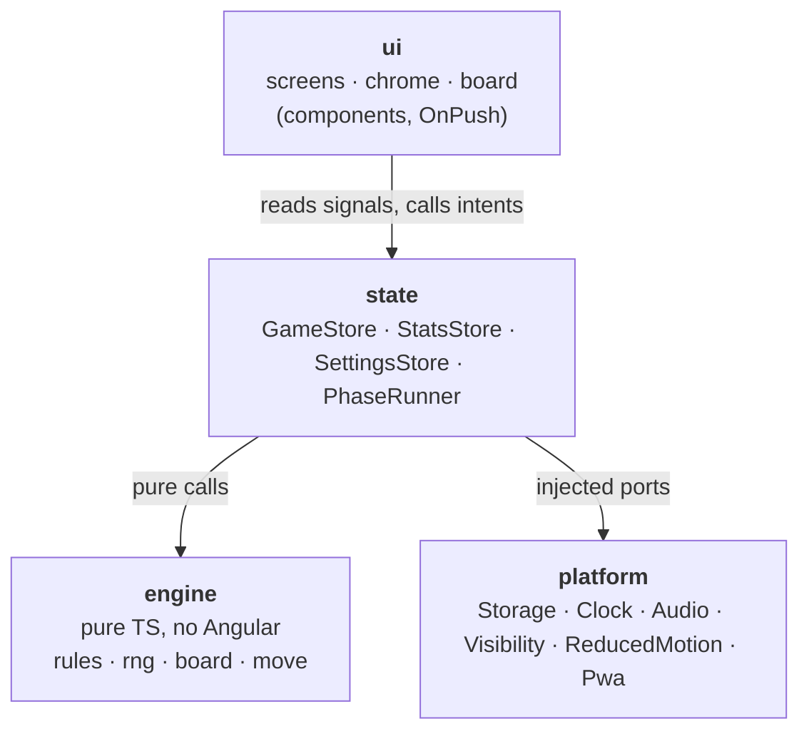

---
aliases:
  - Architecture
tags:
  - bubble-breaker/planning
  - bubble-breaker/phase-3
  - bubble-breaker/architecture
status: accepted
created: 2026-09-27
---
# 03 — Architecture

Inputs: [01-rules.md](01-rules.md), [02-ux.md](02-ux.md). Decisions with trade-offs are recorded as ADRs in [`adr/`](adr/README.md).

## Platform baseline

| Item | Choice |
|---|---|
| Framework | Angular **22.x** (latest stable at planning time: 22.2), standalone components, **zoneless**, signals, `OnPush` everywhere |
| Language | TypeScript strict (`strict`, `noUncheckedIndexedAccess`, `exactOptionalPropertyTypes`), Angular `strictTemplates` |
| Runtime | Node **24 LTS ≥ 24.15** (required by Angular 22; local machine has 24.3 → upgrade), npm |
| Rendering | DOM + CSS, absolutely positioned balls moved by `transform` ([ADR-0003](adr/0003-dom-rendering.md)) |
| PWA | `@angular/service-worker` (ngsw) + `SwUpdate` ([ADR-0007](adr/0007-pwa-ngsw.md)) |
| Language | English only; all UI strings in one `strings.ts` ([ADR-0008](adr/0008-english-only-central-strings.md)) |
| Dependencies at runtime | Angular only. No UI kit, no state library, no validation library |

## Layers



**Dependency rule** (lint-enforced, [ADR-0002](adr/0002-layered-architecture.md)):
- `engine` imports nothing outside itself; no `@angular/*`, no DOM.
- `platform` imports nothing from `state`/`ui`.
- `state` imports `engine` + `platform` interfaces.
- `ui` imports `state` (+ `engine` types only). ui specs may also use engine fixtures and the platform fakes.

## Folder layout

```text
src/
  main.ts
  styles/            tokens.css (verbatim from design), base.css, chrome.css (shared buttons and windows), fonts (self-hosted Noto Sans)
  app/
    app.config.ts    provideZonelessChangeDetection, router, service worker, ports
    app.routes.ts
    strings.ts
    version.ts       VERSION for About (bumped by release-please, Plan 07)
    engine/          rules.ts rng.ts board.ts groups.ts physics.ts move.ts game.ts index.ts (+ *.spec.ts)
    state/           game.store.ts stats.store.ts settings.store.ts phase-runner.ts timer.ts persistence.ts motion.ts format.ts pwa.store.ts
    platform/        clock.ts storage.ts audio.ts visibility.ts reduced-motion.ts pwa.ts provide-platform.ts + testing/fakes.ts
    ui/
      chrome/        shell title-bar status-strip softkey-bar popup-menu confirm-dialog toast
      board/         board-area board board-layout (cell math) ball-look announcer points-bubble live-region
      screens/       screen stat-rows game-screen paused-dialog pwa-notice scoring-screen scoring-guard
                     statistics-screen options-screen how-to-play-screen about-screen
```

Outside `src/`: `ngsw-config.json` (service-worker asset groups), `public/manifest.webmanifest` and `public/icons/` (drawn by `scripts/make-icons.mjs`), `scripts/check-pwa.mjs` and `scripts/check-container.mjs` (CI checks of the build and of the running image), `Dockerfile` + `nginx/default.conf` (the image), `deploy/` (`compose.yml`, `update.sh` + `update.test.sh` for the NAS), and `release-please-config.json` (releases).

## Engine (pure TypeScript)

Framework-free and deterministic. Every function returns new values; nothing is mutated.

```ts
type Color = 0 | 1 | 2 | 3 | 4;           // red, blue, green, yellow, purple
type BallId = number;                      // stable for the whole game: 0 … cols·rows−1
interface Cell { readonly row: number; readonly col: number }

interface Rules {                          // STANDARD_RULES: 11 × 12, 5 colors, minGroup 2 (01-rules.md)
  readonly columns: number;
  readonly rows: number;
  readonly colors: number;
  readonly minGroup: number;
}

interface Board {                          // immutable
  readonly columns: number;
  readonly rows: number;
  readonly cells: readonly (BallId | null)[];   // row-major, index = row·columns + col
}

interface Game {
  readonly seed: number;                   // uint32
  readonly rules: Rules;
  readonly colors: readonly Color[];       // indexed by BallId, never changes
  readonly board: Board;
  readonly score: number;
}

interface MoveResult {                     // everything the UI needs to animate one burst
  readonly removed: readonly BallId[];
  readonly points: number;                 // X·(X−1)
  readonly afterGravity: Board;
  readonly afterCollapse: Board;           // === afterGravity when no column slid
  readonly game: Game;                     // final state
  readonly gameOver: boolean;
}

createRng(seed): () => number              // mulberry32 (same as prototype); internal
newGame(seed, rules = STANDARD_RULES): Game
colorOf(game, id): Color
ballAt(board, cell): BallId | null         // throws RangeError outside the board
isInside(board, cell): boolean
countBalls(board): number
scoreFor(size): number                     // X·(X−1)
groupAt(game, cell): readonly Cell[]       // [] when size < minGroup or empty cell
allGroups(game): readonly (readonly Cell[])[]
burst(game, cell): MoveResult | null       // null when groupAt is empty
hasMoves(game): boolean
```

- `engine/index.ts` is the public API: it re-exports the types and functions above plus `STANDARD_RULES`, but not `createRng` or the physics steps. Later layers import only from it.
- `physics.ts` keeps `applyGravity(board)` and `collapseRight(board)` as separate steps. Later styles can add `shiftRight` or `refillLeft` without touching the existing steps.
- `collapseRight` returns the same `Board` reference when nothing slides; the PhaseRunner skips the slide phase when `afterCollapse === afterGravity`.
- Invariants 1–6 from [01-rules.md](01-rules.md) become fast-check property tests.

## State (signals)

No NgRx ([ADR-0004](adr/0004-signals-no-state-library.md)). Three root-provided stores:

**GameStore**
- State signals:
  - `gameId`: `crypto.randomUUID()` per new game; used for exactly-once stats.
  - `game`: engine `Game`.
  - `selection`: cells + anchor, or null.
  - `phase`: `'idle' | 'pop' | 'fall' | 'slide' | 'over'`.
  - `positions`: BallId → Cell. Drives the transforms and lags `game.board` during animation.
  - `popping`: set of BallIds.
  - `elapsedMs`, `paused`.
  - `cursor`: keyboard cursor; starts in the bottom row, middle column after a deal or a restore.
  - `covered`: a menu, screen or dialog is open; stops the timer.
  - `showScoring`: the game-over hold is over, so the UI navigates to Scoring.
- Derived (`computed`): `selectedPoints`, `selectedText`, `scoreText`, `timeText`, `canInteract`, `cursorGroup` (the group under the cursor, `[]` on an empty cell or a lone ball).
- Intents:
  - `tap(cell)` implements the selection rules R8/R9.
  - `newGame(seed?)`, `pause()`, `resume()`, `setCovered(covered)`, `save()`.
  - Keyboard helpers: `moveCursor`, `activateCursor`, `clearSelection`.
- **PhaseRunner** plays the frames built by `framesFor(before, result, motion)`: pop on the old board, fall to `afterGravity`, slide to `afterCollapse` (skipped when `afterCollapse === afterGravity`), then an `over` hold on game over. It uses the durations from `state/motion.ts` (which mirrors `tokens.css`) and the injected clock. With reduced motion the pop keeps an 80 ms fade and every other duration is 0; zero-length frames apply synchronously. Tests use `FakeClock`.
- At the `over` frame the store clears `paused` (a pause during the final burst must not reach Scoring), stops the timer, records statistics, clears `bb:v1:game` and plays the game-over sound; `showScoring` turns true after the hold.

**StatsStore**
- Holds `high`, `total`, `played`, `last { score, timeMs }`, with `average` computed.
- `recordFinished(gameId, score, timeMs)` is **idempotent**: it keeps `lastRecordedGameId` and ignores repeats (handoff "exactly once").
- `newHigh` (not persisted) marks a record that beat the previous high. `reset()` keeps `lastRecordedGameId`.

**SettingsStore**
- Holds `breakerSet: 'colorful' | 'greyscale'`, `shapeHints`, `sound` and `installDismissedAt` (wall-clock ms of the install notice's "Not now", or null).
- Defaults: Colorful, shape hints off, sound on.

**PwaStore**
- `notice`: `'update' | 'offline' | 'install' | null`, one at a time, most urgent first. Offline ready shows for 4 s. Install needs `StatsStore.played() > 0` and no "Not now" in the last 30 days (`ClockPort.epochMs()`).
- Intents: `reload()` saves the game (`GameStore.save()`), then calls `PwaPort.reload()`; `dismiss()` (× on New version or Offline ready); `install()` (a declined browser prompt counts as "Not now"); `notNow()`.
- It reloads after saving when the service worker is `unrecoverable`, and calls `PwaPort.checkForUpdate()` when the page becomes visible again. `app.config.ts` creates it at start (`provideAppInitializer`).

**Timer**
- Elapsed time is accumulated by `state/timer.ts`. It starts on the first tap that selects a group, runs while the game is not paused, covered or over, and stops at game over. The display updates on whole seconds; saves use the exact value.
- It pauses when a menu, screen or dialog is open, or the page is hidden. Before the first tap a hidden page or `pause()` does nothing (no Paused dialog).
- It never resets on resume (fixes the legacy bug).

## Persistence

- Uses `localStorage` through the `StoragePort`.
- The schema is versioned and every read is validated by hand-written guards. A corrupt or unknown version falls back to defaults and never crashes ([ADR-0005](adr/0005-persistence-schema.md)).

| Key | Content | Written |
|---|---|---|
| `bb:v1:settings` | `{ breakerSet, shapeHints, sound, installDismissedAt }` | on change |
| `bb:v1:stats` | `{ high, total, played, last, lastRecordedGameId }` | on game over |
| `bb:v1:game` | `{ gameId, seed, colors, cells, score, elapsedMs }` | at the deal, after each burst settles, on pause/hidden, when a menu/screen/dialog covers the board, before SW reload; cleared at game over |

- On start, a valid `bb:v1:game` with moves left is restored: in the Paused state if its timer had started (`elapsedMs > 0`), otherwise unpaused. Without one, a new game starts.
- Test hook: when `environment.testHooks` is true (dev and e2e builds only), `?seed=<uint32>` starts a new game with that seed. Production ignores it (see 04). Deferred to Plan 08; `GameStore.newGame(seed?)` already accepts a seed.
- Saves happen after the animation settles, from the final `Game`.
- `bb:v1:game` is also written when a game is dealt, so a reload never restores an abandoned game.
- A saved game without moves is discarded on start.
- A settings record without `installDismissedAt` (written before Plan 06) reads as `null`; the schema stays v1.

## UI

**Routing** ([ADR-0006](adr/0006-routing.md))
- Routes: `''` (game), `scoring`, `statistics`, `options`, `how-to-play`, `about`.
- All components are tiny, so they are eager-loaded.
- Android back and browser back behave naturally. Softkey "Done" navigates to `''`.
- The menu, dialogs and toasts are overlays, not routes.
- Scoring is reached only through game over; a direct visit redirects to `''`.
- Each route has a `title` ("Statistics – Bubble Breaker"); unknown paths redirect to `''`.
- `scoringGuard` lets `/scoring` through only while `GameStore.showScoring()` is true; `App` navigates there when it turns true.

**Board** (`ui/board/`)
- `board-layout.ts` holds the pure layout functions from the handoff §1–2: `cellSize` (unit-tested with the reference viewports), `cellAt` (hit testing), `bubblePlacement` and `translate`.
- `BoardArea` (`bb-board-area`) is the white flex area. A ResizeObserver on its content box (CSS padding `0 4px 4px`) feeds the `cell` input; `cell_max` is read from the `--bb-cell-max` token. A tap on the area beside the board counts as outside (clears the selection). It sits in the Game screen between the status strip and the softkeys.
- `GameBoard` (`bb-board`) is one focusable `role="application"` element. Stacking order: highlight layer (z1) → balls (`@for (ball of balls(); track ball.id)` in id order, z2) → focus ring (z3) → points bubble (z4).
- One `click` handler maps x/y to a cell and calls `GameStore.tap`. A keydown handler drives the cursor: arrows, Enter/Space, Esc, N, M (opens the menu through `Shell`).
- The focus ring shows while the board has focus and the last input was a key or keyboard focus; a pointer press hides it. Pointer taps do not move the cursor.
- Animations are CSS transitions switched by phase classes (`board--fall`, `board--slide`, `cell--popping`) with the motion tokens; the PhaseRunner decides when each phase starts. Popped balls leave the DOM at the fall frame.
- The live region (`bb-live-region`, polite) is a sibling of the board. `announcer.ts` picks one message per input from a before/after snapshot of the store; game over is announced when `phase` becomes `over`. All texts live in `strings.ts`. Every new deal is announced ("New game."), whatever started it.

**Ball**
- A `.cell` wrapper moved by `transform`, holding a `.bb-ball` element with the tokens.css recipe class (`.bb-ball--red`, `.bb-ball--g1`, and so on).
- The shape-hint glyph is an `aria-hidden` child span, shown only on Colorful when shape hints are on.
- The idle look never changes; highlight and focus ring are separate elements behind and above it.

**Chrome** (`ui/chrome/`)
- `Shell` (root service) holds the popup-menu state and the number of open modal dialogs, and knows whether the Game screen shows (`isActive('/')`). `covered = !onGame || menuOpen || dialogs > 0` reaches `GameStore.setCovered` through an effect. Closing the menu gives focus back to its opener; a menu choice that changes screen closes the menu after the navigation, so the timer never runs in between.
- `TitleBar` (26 px banner), `StatusStrip` (Score / Selected / Time; Game screen only), `SoftkeyBar` (New Game or Done, and Menu with `aria-haspopup`/`aria-expanded`), `PopupMenu` (roving focus, wrapping arrows, Home/End, Esc/Tab; a press outside closes it), `ConfirmDialog` (native `<dialog>` with `showModal()`, `role="alertdialog"`, starts on Cancel, Esc dismisses, focus returns) and `Toast` (`role="status"`; optional action and ×, or a stacked layout with a labelled dismiss button and a default action).
- Shared button and window styles live in the global `src/styles/chrome.css`.
- Desktop (`pointer: fine`): `App` draws a 536 × 668 window (`windowSize()` in `board-layout.ts`) with a 3 px bevel on the `#2F6468` backdrop and the key hint below it; below 708 px of height or 560 px of width the window fills the viewport and the cell follows the height.

**Screens** (`ui/screens/`)
- `GameScreen` (route `''`): status strip, `PwaNotice`, board area and `PausedDialog`, a non-modal dialog over the board area (below the softkeys) shown while `GameStore.paused()`; the board area and the notice are `inert` meanwhile. Resume or Esc call `resume()` and focus the board.
- `PwaNotice` (`bb-pwa-notice`) shows `PwaStore.notice()` with `Toast` in the flow above the board area, so the board gives up the height instead of being covered. It leaves with `animate.leave` and gives focus back to the board when a focused notice goes away.
- The other screens use `Screen` (`bb-screen`): an `<h1>` that takes focus after an in-app navigation, above a scrolling white panel. `StatRows` renders the label/value rows.
- `ScoringScreen`, `StatisticsScreen` (reset through `ConfirmDialog`), `OptionsScreen` (native radios and checkboxes bound to `SettingsStore`), `HowToPlayScreen`, `AboutScreen` (`VERSION` from `src/app/version.ts`).

## Platform ports

Abstract classes used as DI tokens, bound by `providePlatform()` in `app.config.ts`; tests use the fakes in `platform/testing/fakes.ts` via `createFakePlatform()`.

- **StoragePort**: `get/set/remove` JSON. `BrowserStorage` resolves `localStorage` on every call and swallows every error with a warning (private mode, quota).
- **ClockPort**: `now()` (monotonic), `epochMs()` (wall clock, for dates kept across sessions), `setTimeout`, `clearTimeout`.
- **AudioPort**: `play('select' | 'pop' | 'gameOver')`. `BrowserAudio` creates or resumes the `AudioContext` on the first play, which always runs inside a tap or key press, and plays sounds synthesized from the legacy designs. It stays silent when Web Audio is unavailable. The GameStore calls it only when sound is on.
- **VisibilityPort**: a `hidden` signal from `visibilitychange`.
- **ReducedMotionPort**: a `reduced` signal from `matchMedia('(prefers-reduced-motion: reduce)')`; false where `matchMedia` is missing.
- **PwaPort** (`platform/pwa.ts`, [ADR-0007](adr/0007-pwa-ngsw.md)):
  - `updateAvailable`: a `VERSION_READY` from `SwUpdate.versionUpdates`.
  - `offlineReady`: on a page the worker did not control at load, every `prefetch` URL of `ngsw.json` is in Cache Storage (checked every 2 s for up to 2 min; ngsw reports no first install).
  - `installAvailable`: a `beforeinstallprompt` was kept (`preventDefault()`); cleared by `install()` and `appinstalled`.
  - `unrecoverable`: from `SwUpdate.unrecoverable`.
  - `checkForUpdate()`, `install()` (the browser prompt; resolves true when accepted) and `reload()`. Saving before a reload is `PwaStore`'s job, because platform may not import state.
  - `providePlatform()` also registers `ngsw-worker.js` with `provideServiceWorker`, in production builds only.

## Error handling

- The engine throws only on programmer error (invalid cell). Tests cover this; the UI never passes an invalid cell.
- The storage port swallows quota and security errors and logs a warning. The game still works without persistence.
- A global `ErrorHandler` logs to the console only. There is no remote telemetry: the About screen promises "no tracking".
- A service-worker `unrecoverable` state triggers a forced reload after saving (`PwaStore`).

## Performance budget

- Initial bundle ≤ 350 kB raw (warn) / 450 kB raw (error). Fonts are subset Latin woff2, 2 weights.
- At most 132 ball nodes, animating only `transform` and `opacity`, with no layout work per frame. No blanket `will-change`; add it only if profiling shows jank.

## Legacy problem → architecture answer

| Legacy problem (00) | Answer |
|---|---|
| Two click paths, split selection | Only `GameStore.tap` / keyboard intents change the selection |
| In-place mutation | Immutable engine |
| Unstable ball ids | `BallId` fixed per game, tracked in `@for` |
| DOM-query animation, hard-coded sizes | PhaseRunner drives `positions`; cell size from layout function |
| No keyboard/ARIA | Board cursor, live region, `role="application"`, native dialog |
| AudioContext before gesture | Lazy create/resume in Audio port |
| Pause resets time | Accumulated elapsed model |
| Best score written every move | Stats written once at game over, idempotent |
| Tests re-implement logic | Tests import engine directly; property tests |
| `ngsw-config` references fake `/api` | Asset groups only |
