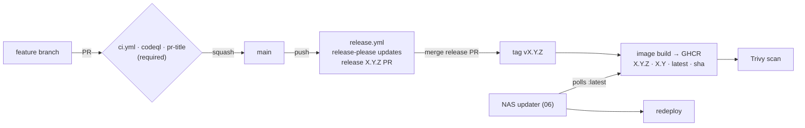

---
aliases:
  - CI/CD & Repo Governance
tags:
  - bubble-breaker/planning
  - bubble-breaker/phase-5
  - bubble-breaker/ci-cd
  - bubble-breaker/github
status: accepted
created: 2026-09-27
---
# 05 — CI/CD & Repo Governance

Inputs: [04-quality.md](04-quality.md) (gates), [06-deployment.md](06-deployment.md) (consumer of the image).

## Repository

| Setting | Value |
|---|---|
| Repo | `github.com/Obichris11/bubble-breaker` |
| Visibility | **Public** (currently private → switch at start of implementation; see prerequisites) |
| Default branch | `main` (created from `rewrite` once the skeleton passes CI). `master` is kept read-only until `main` is the default, then deleted; legacy lives on as tag `v0-legacy` |
| Merge strategy | **Squash only**; commit title = PR title (Conventional Commit); auto-delete head branches |
| Security features (free on public) | Secret scanning + push protection, Dependabot alerts + security updates, private vulnerability reporting, CodeQL |
| Files | `LICENSE` (MIT), `README.md` (play link, screenshots, dev setup), `SECURITY.md`, `CONTRIBUTING.md` (short: DoD from 04), `.github/pull_request_template.md` |

### Ruleset on `main`

- Pull request required (0 approvals: solo developer; PR = CI gate + changelog entry).
- Required status checks: `quality`, `build`, `e2e`, `lighthouse`, `docker`, `pr-title`, `CodeQL`.
- Branch must be up to date before merge; linear history; no force push; no deletion.
- Repo admin may bypass only in emergencies (logged).

### Prerequisites before going public

1. Remove tracked `.claude/settings.local.json`; add `.claude/` to `.gitignore`.
2. **Decided:** existing history (author email) stays as is. Enable GitHub "Keep my email addresses private" and set `git config user.email` to the `…@users.noreply.github.com` address for all new commits. No history rewrite.
3. History scanned 2026-09-27: no secrets, tokens, keys or IPs found.

## Versioning

- SemVer. The rewrite's first release is **2.0.0** (legacy tags `v1.1.0`, `v1.1.1` exist).
- **release-please** (`googleapis/release-please-action`) maintains a "chore(main): release X.Y.Z" PR with a generated `CHANGELOG.md`. `feat` bumps minor, `fix` bumps patch, `feat!` or `BREAKING CHANGE` bumps major.
- **Merging the release PR = shipping.** It creates tag `vX.Y.Z` and a GitHub Release, which triggers the image build.
- release-please bumps `package.json`, `package-lock.json` and `src/app/version.ts` (the line marked `x-release-please-version`); the About screen shows `VERSION`.
- Config: `release-please-config.json` (`release-type: node`, tags `vX.Y.Z`, `initial-version: 2.0.0`, `bootstrap-sha` = `v0-legacy`) and `.release-please-manifest.json` (`{}` until the first release). The legacy tags `v1.1.x` have no GitHub Releases and are not in the manifest, so the first release is 2.0.0 and its changelog starts after the legacy code. `CHANGELOG.md` is generated; Prettier ignores it.

## Workflows (`.github/workflows/`)

All workflows follow these rules:
- `permissions: {}` at the top level and minimal grants per job.
- Third-party actions pinned by commit SHA (Dependabot bumps them).
- `concurrency` cancels superseded runs.
- Node version comes from `.nvmrc`, with an npm cache and `npm ci`.

### `ci.yml` (on `pull_request`, `push: main`)

| Job | Needs | Steps | Artifacts |
|---|---|---|---|
| `quality` | – | lint · `prettier --check` · typecheck · unit+component tests with coverage thresholds | coverage report |
| `build` | – | `ng build` (production, budgets enforced) · `npm run check:pwa` | `dist/` |
| `e2e` | build | Playwright (Chromium + WebKit, desktop + mobile) against static-served `dist/` built with test hooks · axe · visual snapshots | Playwright report + traces on failure |
| `lighthouse` | build | Lighthouse CI, mobile, assertions from 04 | LH report |
| `docker` | – | actionlint + shellcheck · `npm run test:deploy` · `docker build` · `docker compose -f deploy/compose.yml up --wait` (the NAS settings) · `npm run check:container` (health, cache rules, SPA fallback and 404s, headers, no inline script) | – |

`docker` builds the app inside the image (multi-stage), so it does not wait for `build`.

`pr-title.yml` (on `pull_request`: opened / edited / synchronize) checks the PR title with `amannn/action-semantic-pull-request`.

### `codeql.yml`

- Triggers: PRs, pushes to `main`, and a weekly schedule.
- Languages: `javascript-typescript` and `actions`.

### `release.yml` (on `push: main`)

1. Job `release-please` runs the action. When `release_created` is true, it outputs `tag` and `version`.
2. Job `image` runs if a release was created. Permissions: `contents: read`, `packages: write`, `id-token: write`, `attestations: write`, `security-events: write`.
   1. Log in to GHCR with `GITHUB_TOKEN`.
   2. Build with `docker/build-push-action` for `linux/amd64` only (DS224+ is x86-64), with OCI labels (source, version, revision). The Dockerfile builds the app itself (multi-stage, see 06).
   3. Push only `:sha-<short>`, with `provenance: mode=max` and `sbom: true`.
   4. Trivy (`aquasecurity/trivy-action`, Trivy 0.70) scans that digest. It fails on fixable `CRITICAL`/`HIGH`; the SARIF goes to code scanning (category `trivy-image`).
   5. Only a clean digest gets `X.Y.Z`, `X.Y` and `latest` (`docker buildx imagetools create`), then `actions/attest-build-provenance`. A failed scan leaves the GitHub Release but not `:latest`; fix forward with a patch release.
3. The NAS picks up `:latest` (see 06).
4. `concurrency: release`, never cancelled.

> [!WARNING]
> **Token caveat:** PRs opened with `GITHUB_TOKEN` do not trigger other workflows. The release PR would therefore never get its required checks.
- Use a **fine-grained PAT** stored as secret `RELEASE_PLEASE_TOKEN`: scoped to this repo, with `contents`, `issues` and `pull-requests` read/write (release-please manages its `autorelease:` labels), 1-year expiry and a calendar reminder.
- Alternative: a small GitHub App (more setup, no expiry).

### `dependabot.yml`

| Ecosystem | Schedule | Grouping |
|---|---|---|
| npm | weekly | `angular` (all `@angular/*`, `angular-eslint`), `test-tooling` (vitest, playwright, testing-library, fast-check, axe), `lint-format`, others individually |
| github-actions | weekly | all in one group |
| docker | weekly | one group `base-images` (digests of `node:24-alpine` and `nginx-unprivileged:stable-alpine-slim`) |

Angular major upgrades are done manually with `ng update`, and Dependabot ignores `@angular/*` major versions.

## Secrets & tokens

| Name | Where | Scope |
|---|---|---|
| `GITHUB_TOKEN` | automatic | per-job minimal permissions |
| `RELEASE_PLEASE_TOKEN` | repo secret | fine-grained PAT, this repo, `contents`, `issues` and `pull-requests` read/write (release-please manages its `autorelease:` labels) |

No other secrets are needed: the GHCR package is public, so the NAS pulls anonymously.

## One-time manual steps

1. Flip the repo to public (after the prerequisites).
2. Create `main`, set it as default, add the ruleset, delete `master`.
3. Create `RELEASE_PLEASE_TOKEN`.
4. After the first image push, set the GHCR package **visibility to public** and link it to the repo (package settings).
5. Enable secret scanning push protection and private vulnerability reporting.
6. After the Plan 07 PR merged and `docker` reported on `main`, add `docker` to the ruleset's required checks (Plan 07, Part 2, B2).

## Flow summary

