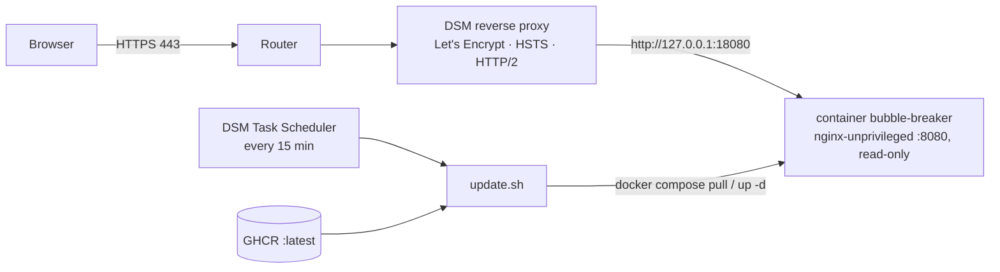

---
aliases:
  - Deployment & Operations
tags:
  - bubble-breaker/planning
  - bubble-breaker/phase-6
  - bubble-breaker/deployment
  - bubble-breaker/synology
status: accepted
created: 2026-09-27
---
# 06 — Deployment & Operations

Target: Synology DS224+ (x86-64), DSM 7.2+, Container Manager. Public internet on the user's own domain via the existing DSM reverse proxy. Image source: `ghcr.io/obichris11/bubble-breaker` (public, built by [05-cicd.md](05-cicd.md)).

The server is stateless: all player data lives in the browser (localStorage). Nothing on the NAS needs a backup except `compose.yml` and `update.sh`, and both are versioned in the repo under `deploy/`.

## Topology



## Image (`Dockerfile`, multi-stage)

| Stage | Base | Does |
|---|---|---|
| `build` | `node:24-alpine` (digest-pinned) | `npm ci` → `ng build --configuration production` |
| `runtime` | `nginxinc/nginx-unprivileged:stable-alpine-slim` (digest-pinned) | Copies `dist/bubble-breaker/browser` and `nginx/default.conf` (as `/etc/nginx/conf.d/default.conf`; the image's `nginx.conf` keeps pid and temp files in `/tmp`); runs as uid 101 on port **8080** |

- `HEALTHCHECK --interval=30s --timeout=3s --start-period=10s --start-interval=2s CMD wget -qO- http://127.0.0.1:8080/health || exit 1` (`--start-interval` needs Docker ≥ 25; older engines run the first check after 30 s).
- The slim variant (21 Alpine packages, no curl) keeps Trivy clean: on 2026-10-29 `stable-alpine` had fixable CRITICAL/HIGH findings in brotli-libs and curl. The image is 30 MB on disk, 8.5 MB compressed.
- OCI labels (`org.opencontainers.image.source/version/revision`) are set by CI.
- `.dockerignore` excludes `.git`, `.github`, `.angular`, `.claude`, `.husky`, `.vscode`, `coverage`, `deploy`, `dist`, `docs`, `e2e`, `node_modules`, `*.md`.
- Local check: `docker build -t ghcr.io/obichris11/bubble-breaker:latest . && docker compose -f deploy/compose.yml up -d --pull never --wait && npm run check:container`.

## nginx (`nginx/default.conf`)

- `server_tokens off`. Access log goes to stdout, with `/health` excluded. Gzip is on for text types.

**Caching**

| Path | `Cache-Control` |
|---|---|
| `/index.html`, `/ngsw.json`, `/ngsw-worker.js`, `/safety-worker.js`, `/worker-basic.min.js`, `/manifest.webmanifest` | `no-cache` |
| Hashed bundles `*-<HASH>.js/css`, `/media/*` | `public, max-age=31536000, immutable` |
| Fonts, icons, favicon (`/fonts/*`, `/icons/*`, `/favicon.ico`; same names in every release) | `public, max-age=604800` |

`Cache-Control` is sent on successful responses only, so errors are never cached. The manifest is served as `application/manifest+json`.

**Routing**
- Known SPA routes (no file extension) → `try_files $uri /index.html`.
- A missing file with an extension (any last path segment with a dot, e.g. `/x.js`, `/about.txt`) → real **404**, never index.html.
- `/health` returns `200 ok`, `text/plain`.

**Security headers** (sent by the container; HSTS is set at the DSM proxy)
- `Content-Security-Policy`:
  - `default-src 'self'`
  - `script-src 'self'`
  - `style-src 'self' 'unsafe-inline'` (needed for Angular component styles)
  - `img-src 'self' data:`, `font-src 'self'`, `connect-src 'self'`
  - `worker-src 'self'`, `manifest-src 'self'`
  - `base-uri 'self'`, `form-action 'none'`, `frame-ancestors 'none'`
- `script-src 'self'` allows no inline script, so production builds set `optimization.styles.inlineCritical: false`: critical-CSS inlining adds an inline `<script>` that swaps the stylesheet's `media`, and under this CSP the stylesheet would stay `media="print"`. `security.autoCsp` does not help: its inline loader scripts are still blocked by the header. `check:container` fails on any inline script or `on*=` attribute in `index.html`; Plan 07's browser check found no CSP violation with the service worker active.
- Other headers:
  - `X-Content-Type-Options: nosniff`
  - `Referrer-Policy: no-referrer`
  - `Permissions-Policy: camera=(), microphone=(), geolocation=(), payment=(), usb=()`
  - `Cross-Origin-Opener-Policy: same-origin`
- The headers are sent on every response (`always`); `add_header_inherit merge` (nginx ≥ 1.29.3) keeps them in the locations that add `Cache-Control`.
- CI `docker` job asserts these headers and the cache rules (`scripts/check-container.mjs`, see 05).

## Runtime (`deploy/compose.yml` on the NAS)

```yaml
# Bubble Breaker on the NAS (06-deployment "Runtime"). Lives in /volume1/docker/bubble-breaker/
# next to update.sh. To roll back, pin `image:` to a released X.Y.Z instead of latest.
name: bubble-breaker
services:
  bubble-breaker:
    image: ghcr.io/obichris11/bubble-breaker:latest
    container_name: bubble-breaker
    restart: unless-stopped
    ports:
      - '127.0.0.1:18080:8080' # only the DSM reverse proxy can reach it
    read_only: true
    tmpfs:
      - /tmp
    cap_drop: [ALL]
    security_opt: [no-new-privileges:true]
    mem_limit: 64m
    pids_limit: 64
    logging:
      driver: json-file
      options: { max-size: '1m', max-file: '3' }
```

- Verified in Plan 07: with `read_only` and a tmpfs on `/tmp` the container starts healthy in about 3 s and uses about 5 MiB of RAM and 5 PIDs. `name: bubble-breaker` makes Container Manager and `update.sh` manage the same project.
- Host port 18080 is a placeholder; choose any free port.

## DSM configuration (one-time)

`<nas>` is the NAS's LAN name or IP, `<admin>` an administrator account, `<game-domain>` your hostname (never in the repo). Run C1–C4, then the updater task (C5, next section), then C6 and C7.

- **C1: check the tools.** Control Panel → Terminal & SNMP → enable SSH. Then from your machine:

  ```bash
  ssh -t <admin>@<nas> 'sudo -i sh -c "command -v docker flock; docker version --format {{.Server.Version}}; docker compose version || docker-compose version"'
  ```

  Expected: `/usr/local/bin/docker` and a `flock` path; a server version (Docker ≥ 25 gets the fast health start, older works with the 30 s first check); a compose v2 version. If `flock` is missing, stop and report: `update.sh` needs it.

- **C2: retire the legacy container first** (its name is probably `bubble-breaker` too, which would block the new one). Container Manager → Container → old `bubble-breaker` → Action → Stop, then Delete; Image → delete the old image. Keep its reverse-proxy entry for C6. The site is down from here until C4.

- **C3: folder and files.** File Station → shared folder `docker` → Create folder `bubble-breaker`. Copy the two files from your clone of `main`:

  ```bash
  ssh <admin>@<nas> 'cat > /volume1/docker/bubble-breaker/compose.yml' < deploy/compose.yml
  ```

  ```bash
  ssh <admin>@<nas> 'cat > /volume1/docker/bubble-breaker/update.sh' < deploy/update.sh
  ```

- **C4: Container Manager project.** Container Manager → Project → Create. Project name `bubble-breaker`; Path `/docker/bubble-breaker`; Source: use the existing compose file. If Container Manager only offers to create a `docker-compose.yml`, paste the content of `compose.yml` there and delete `compose.yml` (compose and `update.sh` read either name). Skip the Web Station portal. Next → Done: it pulls `ghcr.io/obichris11/bubble-breaker:latest` (public since B3) and starts it. Check:

  ```bash
  ssh -t <admin>@<nas> 'curl -s http://127.0.0.1:18080/health; sudo docker inspect -f "{{.State.Health.Status}}" bubble-breaker'
  ```

  Expected: `ok` and `healthy`.

- **C6: certificate and reverse proxy.**
  1. Control Panel → Security → Certificate → Add → Add a new certificate → Get a certificate from Let's Encrypt: domain `<game-domain>`, your email. Port 80 must reach the NAS for the challenge (or use DNS-01 if DSM supports your provider).
  2. Control Panel → Login Portal → Advanced → Reverse Proxy: edit the legacy entry (or Create): Source `HTTPS`, hostname `<game-domain>`, port 443, ✓ **Enable HSTS**; Destination `HTTP`, `localhost`, port **18080**. No custom headers. Save. Enable HTTP/2 where your DSM offers it (DSM 7.2: Control Panel → Network → Connectivity → Enable HTTP/2).
  3. Control Panel → Security → Certificate → Settings: assign the new certificate to `<game-domain>`.

- **C7: verify from outside.** On mobile data or from another network, and from your clone:

  ```bash
  curl -sI https://<game-domain>/health
  ```

  ```bash
  node scripts/check-container.mjs https://<game-domain> --public
  ```

  Expected: `HTTP/2 200` (or `HTTP/1.1 200`) with `strict-transport-security`; `Container check passed for https://<game-domain> (86 checks)`. If the headers differ, the DSM proxy changed them; fix the proxy entry, not the container.

## Updater (DSM Task Scheduler)

- **C5: updater task.** Control Panel → Task Scheduler → Create → Scheduled Task → User-defined script.
  - General: Task `bubble-breaker update`, User `root`, Enabled.
  - Schedule: Run on the following days → Daily; First run time 00:00; Frequency every 15 minutes; Last run time 23:45.
  - Task Settings: ✓ Send run details by email, ✓ only when the script terminates abnormally (needs Control Panel → Notification → Email set up); Run command `bash /volume1/docker/bubble-breaker/update.sh`.
  - OK, select the task → **Run**. Expected: no email; `/volume1/docker/bubble-breaker/update.log` stays empty because the running image already is `:latest`.

`deploy/update.sh` (behavior):
1. `cd` to its folder, `set -euo pipefail`, append `/usr/local/bin:/usr/bin:/bin` to `PATH`, take `flock -n .update.lock` (a busy run makes the next one exit 0).
2. Use `docker compose`, or `docker-compose` when the plugin is missing.
3. `compose pull -q` (its output is shown only when the pull fails, which exits 1).
4. Compare the running container's image ID with the configured tag's ID. Equal: exit 0 silently, unless the container is stopped or `unhealthy`, which exits 1 on every run until it is fixed (a stopped container is not started: it may be stopped on purpose). If the last log line is a `FAILED` deploy and the container is now `healthy`, prune and log `recovered <version>`.
5. Different (new release, rollback pin or first run): `compose up -d --remove-orphans`, then wait up to 90 s for `healthy` (covers Docker < 25, whose first check is at 30 s). `compose up` fails or not healthy: log `FAILED <old> -> <new>: <reason>`, print the last 50 container log lines, **exit 1** (DSM emails). There is no automatic rollback; see Rollback. Healthy: prune dangling images with this repo's source label and log `<old> -> <new>` (`none` on the first run).
6. `update.log` keeps the last 500 lines.

On the NAS, verify the docker binary path (`/usr/local/bin/docker`) and that `docker compose` (v2) is available. DSM 7.2 Container Manager ships both.

The worst-case delay between a release and it being live is ~15 min plus the CI build time.

## Rollback

1. Edit `compose.yml`: change `image:` from `:latest` to the previous `:X.Y.Z`. The updater then keeps that pin, because it pulls whatever tag is configured.
2. Run the task manually (Task Scheduler → Run) or `bash update.sh`.
3. Fix forward via a new release, then set the tag back to `:latest`.

Clients: the service worker picks up the rolled-back version like any other update, via the "New version" toast.

## Monitoring

- The container `HEALTHCHECK` status is visible in Container Manager.
- The updater emails on a failed pull, on a failed deploy, and on every run while the container is stopped or unhealthy.
- Optional: an external uptime check on `https://<game-domain>/health` (e.g. an Uptime Kuma instance elsewhere, or a free hosted monitor). Not needed for v1.

## PWA deployment requirements

- HTTPS on the public hostname; the service worker requires it.
- The manifest has `name`, `short_name`, `start_url: "/"`, `scope: "/"`, `display: "standalone"`, and `theme_color` / `background_color` from the design tokens (`public/manifest.webmanifest`; `short_name` "Bubbles", `id` `/`, theme `#0A246A`, background `#D4D0C8`).
- Icons at 192 and 512 px, plus a 512 px maskable icon and a 180 px `apple-touch-icon`, in `public/icons/` (drawn by `npm run icons`).
- `ngsw-config.json` uses asset groups only:
  - app shell (`index.html`, manifest, favicon, JS, CSS) + fonts: `prefetch`;
  - icons: `lazy`.

## Release checklist (manual, per release)

1. The release PR is green, then merge it.
2. The `image` job is green: Trivy clean (code scanning, category `trivy-image`), tags `X.Y.Z`, `X.Y`, `latest` on one digest.
3. Within 15 min, check that `https://<game-domain>/` shows the new version on the About screen.
4. `node scripts/check-container.mjs https://<game-domain> --public` passes (86 checks).
5. On a phone, the "New version" toast appears, reloading works, and the game in progress is preserved.
